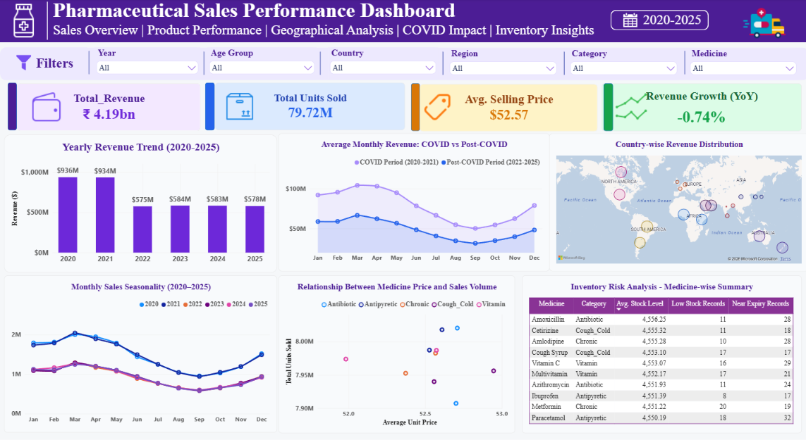

# Pharmaceutical Sales Performance & Inventory Analysis Dashboard

**An End-to-End Business Intelligence Project | Power BI | PostgreSQL | SQL | DAX**


---

## 1. Executive Summary

This project was developed as part of my **Data Analytics Internship at Arrowstack Technologies** to analyse pharmaceutical sales performance, product pricing, geographical distribution and inventory-related indicators.

Using PostgreSQL, SQL and Microsoft Power BI, I transformed 177,990 pharmaceutical sales records into an interactive business intelligence dashboard. The analysis covers six years (2020–2025) and provides insights into sales trends, monthly seasonality, COVID-period comparisons, product-level performance and inventory risk observations.

The final outcome is a single-page interactive Power BI dashboard designed to support sales performance monitoring and exploratory business decision-making.

## 2. Key Insights & Business Recommendations

### Key Findings

- **Sales Performance:** The dataset contains 79.72 million units sold, with calculated revenue of approximately 4.19 billion (in dollors).
- **Annual Trends:** Revenue was substantially higher in 2020 and 2021 than in the subsequent years.
- **Monthly Seasonality:** Sales volume generally peaks around March and declines towards September, followed by a recovery towards December.
- **Product Performance:** Medicine-wise revenue and sales quantities show relatively similar distributions across the 10 medicines.
- **COVID Comparison:** Category-wise sales composition appears broadly similar between the COVID and post-COVID periods.
- **Inventory Monitoring:** Using exploratory thresholds, 139 low-stock observations and 233 near-expiry observations were identified.

### Business Recommendations

- Monitor annual sales performance to identify changes in revenue and sales volume.
- Consider monthly seasonality when planning sales and inventory activities.
- Investigate the substantial difference between 2020–2021 and subsequent annual revenue levels.
- Review medicines with repeated low-stock observations to identify potential replenishment requirements.
- Prioritise observations with shorter expiry periods for further inventory verification.
- Monitor geographical sales distribution to understand differences across markets.

*These findings are descriptive. They do not establish causal relationships or confirm actual physical inventory shortages.*

## 3. Dashboard Preview

The dashboard brings together five analytical areas:

1. Sales Performance Overview
2. Sales Trend Analysis
3. Geographical Revenue Distribution
4. Product Pricing Analysis
5. Inventory Risk Analysis

### Dashboard Screenshot



*Interactive dashboard developed using Microsoft Power BI.*

**Dashboard Features:**
- Interactive KPI cards
- Year, age group, country, region, category and medicine filters
- Yearly and monthly sales trend visualisations
- COVID vs. Post-COVID comparison
- Country-wise revenue map
- Medicine price and sales volume scatter chart
- Medicine-wise inventory risk summary

**Power BI File:** `pharma_sales_dashboard.pbix`

## 4. Problem Statement & Objectives

### Problem Statement

Pharmaceutical sales data contains information about products, transactions, geographical markets, pricing and inventory. However, analysing these records separately makes it difficult to obtain a consolidated understanding of business performance.

This project addresses the need for an interactive analytical solution that combines sales, product, geographical and inventory information in a single dashboard.

### Project Objectives

- Analyse overall pharmaceutical sales performance from 2020 to 2025.
- Identify yearly revenue trends and monthly sales patterns.
- Compare sales performance across COVID and post-COVID periods.
- Explore geographical revenue distribution across countries and regions.
- Examine medicine pricing and sales-volume relationships.
- Identify low-stock and near-expiry inventory observations.

### Key Performance Indicators

| KPI | Description |
|---|---|
| Total Revenue | Sum of units sold multiplied by unit price |
| Total Units Sold | Total quantity of medicines sold |
| Average Selling Price | Total revenue divided by total units sold |
| Revenue Growth (YoY) | Percentage change in revenue compared with the previous year |
| Average Stock Level | Average recorded stock level |
| Minimum Expiry Days | Minimum recorded remaining expiry period |

## 5. Dataset Overview

The project uses a pharmaceutical sales dataset covering January 2020 to December 2025.

### Dataset Summary

| Attribute | Details |
|---|---:|
| Total Records | 177,990 |
| Total Columns | 14 |
| Unique Medicines | 10 |
| Product Categories | 5 |
| Countries | 19 |
| Geographical Regions | 8 |
| Time Period | 2020–2025 |
| Total Units Sold | 79,724,186 |
| Calculated Revenue | 4,190,812,220.72 |
| Weighted Average Unit Price | 52.57 |

### Dataset Variables

| Variable | Description |
|---|---|
| date | Transaction date |
| year | Year |
| month | Month |
| day | Day |
| region | Geographical region |
| country | Country |
| category | Medicine category |
| medicine | Medicine name |
| age_group | Customer age group |
| units_sold | Quantity sold |
| unit_price | Unit selling price |
| stock_level | Recorded stock level |
| expiry_days_remaining | Remaining expiry days |
| covid_flag | COVID-period indicator |

**Data Source:** Pharmaceutical sales CSV supplied for the internship project. A public source URL and redistribution licence were not provided.

## 6. Tools & Technology Stack

| Technology | Purpose |
|---|---|
| PostgreSQL | Database storage and management |
| SQL | Data exploration and querying |
| Microsoft Power BI | Interactive dashboard development |
| Power Query | Data preparation and transformation |
| DAX | Measures and calculated columns |
| Microsoft Excel | Data inspection and validation |

## 7. Methodology & Analytical Workflow

### Step 1: Data Exploration

- Examined the dataset structure and dimensions.
- Identified unique medicines, categories, countries and regions.
- Checked date coverage and variable types.
- Reviewed numerical and categorical attributes.

### Step 2: Data Quality Assessment

- Checked all 14 columns for missing values.
- Identified 2,630 exact duplicate rows.
- Reviewed data types and consistency.
- Examined repeated observations in stock and expiry fields.

*Duplicate identification does not automatically imply that all repeated records should be removed; transaction-level and observation-level context must be considered.*

### Step 3: Database Integration

- Imported the pharmaceutical sales dataset into PostgreSQL.
- Created the `pharma_sales` table.
- Connected PostgreSQL to Power BI.
- Retrieved data for dashboard development.

### Step 4: Data Transformation

- Checked and adjusted column data types using Power Query.
- Prepared date-related fields for time-based analysis.
- Created month names and month-number fields for chronological sorting.
- Prepared categorical fields for interactive filtering.

### Step 5: DAX Calculations

Developed measures for revenue, total units sold, average selling price and year-over-year growth.

### Step 6: Exploratory Data Analysis

Performed descriptive analysis of:
- Annual revenue performance
- Monthly sales seasonality
- Country-wise revenue distribution
- Medicine pricing and sales volume
- COVID and post-COVID comparisons
- Stock and expiry observations

### Step 7: Dashboard Development

Designed a single-page Power BI dashboard with interactive slicers, KPI cards, line charts, column charts, map visualisation, scatter chart and inventory summary table.

## 8. Key DAX Measures

### Total Revenue

```dax
Total_Revenue =
SUMX(
    pharma_sales,
    pharma_sales[units_sold] *
    pharma_sales[unit_price]
)
```

### Total Units Sold

```dax
Total Units Sold =
SUM(pharma_sales[units_sold])
```

### Average Selling Price

```dax
Average Selling Price =
DIVIDE(
    [Total_Revenue],
    [Total Units Sold]
)
```

### Revenue Growth (Year-over-Year)

```dax
Revenue Growth YoY % =
VAR SelectedYear =
    SELECTEDVALUE(pharma_sales[year])

VAR CurrentRevenue =
    CALCULATE(
        [Total_Revenue],
        REMOVEFILTERS(pharma_sales[year]),
        pharma_sales[year] = SelectedYear
    )

VAR PreviousRevenue =
    CALCULATE(
        [Total_Revenue],
        REMOVEFILTERS(pharma_sales[year]),
        pharma_sales[year] = SelectedYear - 1
    )

RETURN
    DIVIDE(
        CurrentRevenue - PreviousRevenue,
        PreviousRevenue
    )
```

## 9. Repository Structure

```text
Pharma-Sales-Analytics/
│
├── README.md
│
├── global_pharmacy_sales_2020_2025_daily_dataset.csv 
│
├── pharma.sql
│
├── pharma_sales_dashboard.pbix
│
└── pharma_sales_dashboard.png
```

*The directory structure represents the recommended repository organisation. Include only the files you have actually uploaded.*

## 10. How to Reproduce the Project

### Prerequisites

- PostgreSQL
- pgAdmin
- Microsoft Power BI Desktop
- Access to the project CSV dataset

### Step 1: Download the Repository

```bash
git clone https://github.com/g-janani1312/Pharma-Sales-Analytics.git
```

### Step 2: Create a PostgreSQL Database

```sql
CREATE DATABASE pharma_sales_db;
```

### Step 3: Import the Dataset

Import the CSV file into PostgreSQL using pgAdmin's Import/Export functionality.

Use the table name:

```text
pharma_sales
```

### Step 4: Connect Power BI

1. Open Power BI Desktop.
2. Select Get Data.
3. Choose PostgreSQL Database.
4. Enter your PostgreSQL server and database details.
5. Select the `pharma_sales` table.
6. Choose Import mode.
7. Load the data into Power BI.

### Step 5: Open the Dashboard

Open:

```text
pharma_sales_dashboard.pbix
```

Refresh the data after configuring the PostgreSQL connection.

**Note:** This project uses SQL and Power BI rather than Python notebooks. A Python `requirements.txt` file is therefore not required.

## 11. Limitations & Future Scope

### Limitations

- The dataset does not specify a verified currency, so calculated revenue is reported in unspecified currency units.
- Revenue is calculated using units sold multiplied by unit price; discounts, taxes and returns are not separately available.
- COVID and post-COVID comparisons are descriptive and do not establish causal effects.
- Stock and expiry fields contain repeated observations. Record counts should not be interpreted as unique physical inventory batches.
- The low-stock threshold (below 100) and near-expiry threshold (30 days or fewer) are exploratory assumptions rather than official inventory standards.
- No formal statistical hypothesis testing or causal modelling was performed.

### Future Scope

- Develop more detailed country-wise and region-wise performance comparisons.
- Investigate sales forecasting using time-series models.
- Explore medicine-level demand patterns and price sensitivity.
- Develop inventory replenishment indicators.
- Analyse expiry risk using batch-level data, if available.
- Incorporate profit margins, discounts and operating costs when additional data becomes available.

## 12. Contact & Portfolio

**G. Janani**

M.Sc. Agricultural Statistics | Aspiring Data Analyst

- GitHub: [g-janani1312](https://github.com/g-janani1312)
- LinkedIn: [(https://www.linkedin.com/in/janani-g-630323410)]

---

**Project developed as part of the Data Analytics Internship at Arrowstack Technologies.**

*This project demonstrates practical application of SQL, PostgreSQL, Power BI, DAX, data transformation and business intelligence techniques.*
